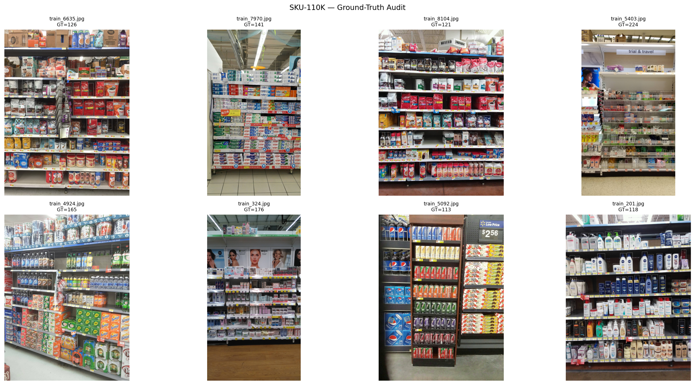
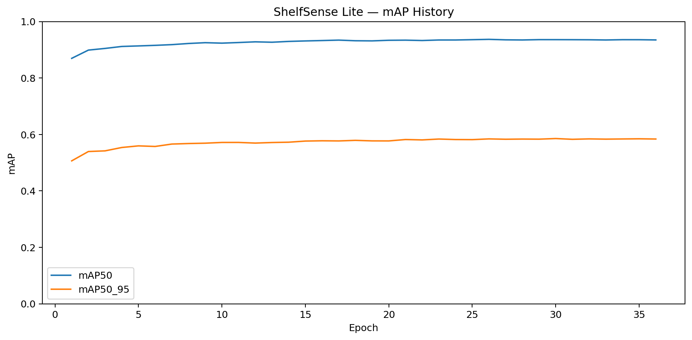
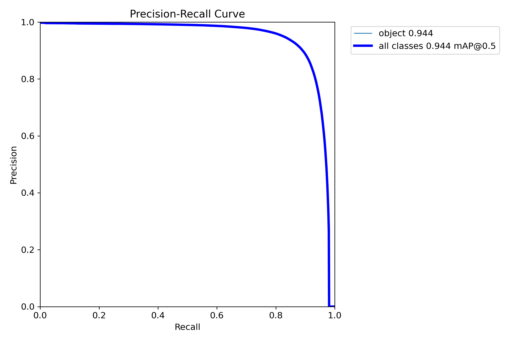
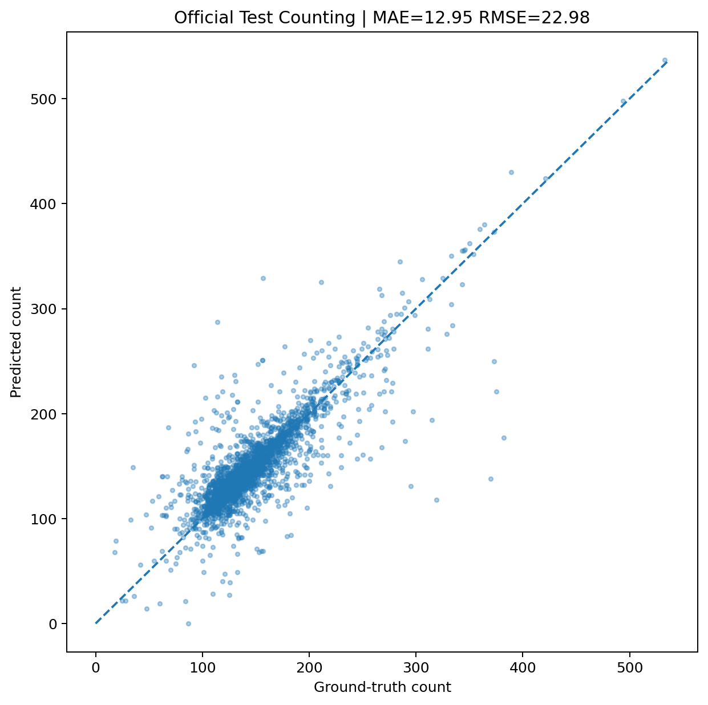
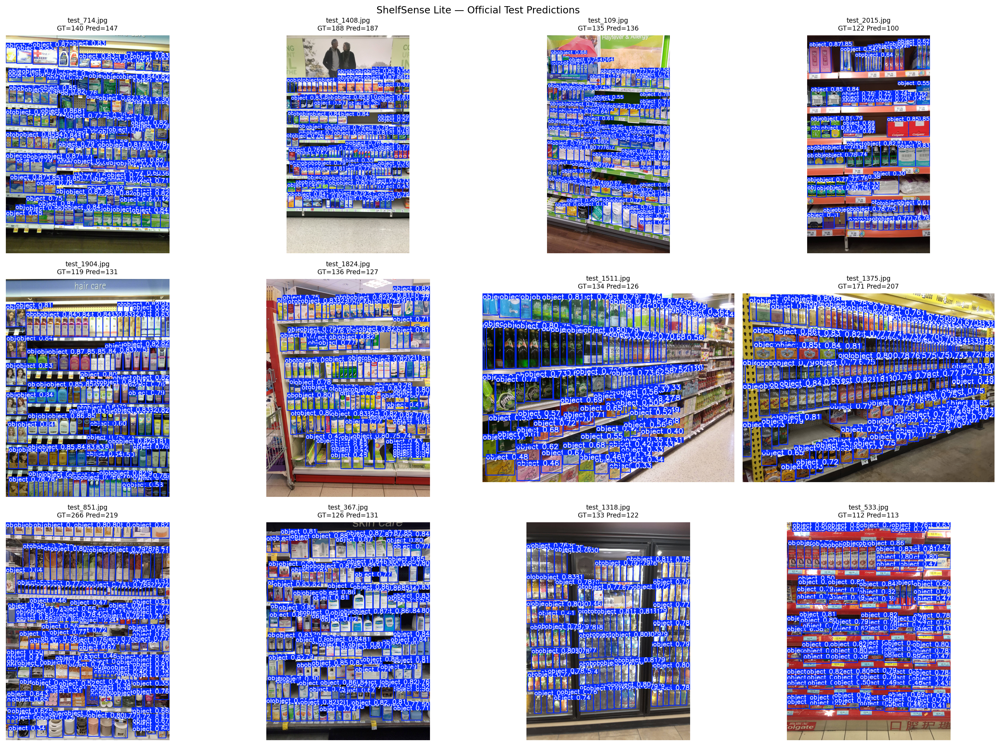
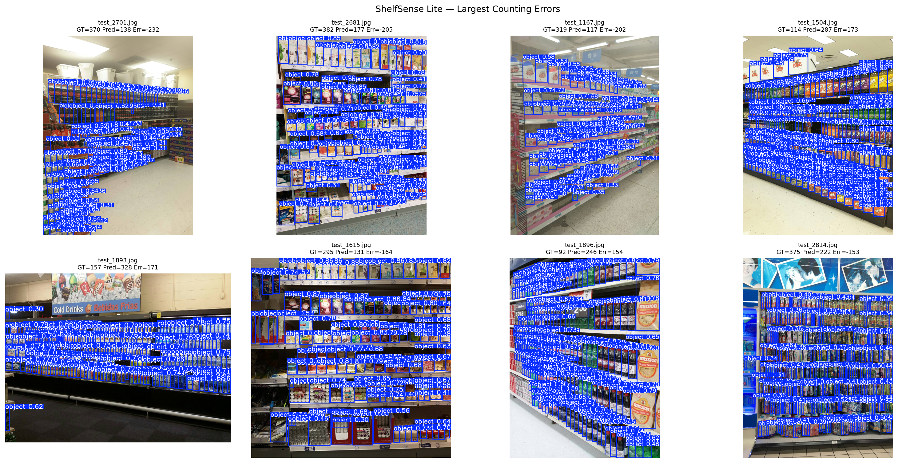

# AGENTS.md — ShelfSense Lite

This document defines the operational contract for AI coding agents and contributors working on ShelfSense Lite.

Its purpose is to prevent scope drift, unsupported claims, accidental data leakage, silent metric changes, benchmark corruption, destructive file operations, and misleading retail/inventory wording.

---

## 1. Project Identity

```text
Project           ShelfSense Lite
Portfolio         11%
Task              Dense retail-product detection
Derived task      Visible-product counting
Model             YOLO11s
Input size        960
Classes           1
Class name        object
App               Streamlit
```

Champion:

```text
models/shelfsense_yolo11s_best.pt
```

---

## 2. Source of Truth

```text
1. reports/final_summary.json
2. reports/test_detection_metrics.json
3. reports/test_count_metrics.json
4. reports/validation_detection_metrics.json
5. reports/best_epoch_summary.json
6. reports/source_audit.json
7. reports/converted_dataset_audit.json
8. notebooks/shelfsense-lite part 2.ipynb
9. notebooks/shelfsense-lite part 1.ipynb
10. README.md
```

Never alter machine-readable reports merely to make prose look consistent.

---

## 3. Locked Champion

```text
YOLO11s
```

Checkpoint:

```text
models/shelfsense_yolo11s_best.pt
```

Training:

```text
36 epochs
best epoch = 30
```

Best training-validation checkpoint:

```text
Precision   0.91177
Recall      0.87349
mAP50       0.93585
mAP50-95    0.58545
```

Final validation:

```text
Precision   0.9119463084
Recall      0.8735668457
mAP50       0.9358892967
mAP50-95    0.5866980113
```

Official test:

```text
Precision   0.9106692193
Recall      0.8819945144
mAP50       0.9435687019
mAP50-95    0.5917975453
```

Counting:

```text
selected confidence = 0.30
test n              = 2935
MAE                 = 12.9499148211
RMSE                = 22.9750179117
bias                = +1.9202725724
mean GT             = 145.2160136286
mean prediction     = 147.1362862010
```

---

## 4. Claim Boundaries

Supported:

```text
dense retail-product detection
visible-product detection
visible-product counting
detection-derived counting
YOLO11s
SKU-110K
```

Unsupported:

```text
SKU recognition
brand recognition
inventory accuracy
physical stock
hidden inventory
stock availability
planogram compliance
```

Never describe `mAP50 = 94.36%` as `94.36% accuracy`.

Never describe detection confidence as inventory certainty.

---

## 5. Dataset Contract

Dataset:

```text
SKU-110K
```

Official source:

```text
https://github.com/eg4000/SKU110K_CVPR19
```

Canonical splits:

```text
train = 8219
val   = 588
test  = 2936
total = 11743
```

Valid boxes:

```text
train = 1,193,564
val   = 89,937
test  = 426,335
```

Invalid rows:

```text
train = 14,918
val   = 1,031
test  = 5,211
```

Density maximum:

```text
train = 575
val   = 718
test  = 533
```

Final evaluation uses `max_det = 800`.

---

## 6. Dataset Mutation Rules

Agents must not silently:

- reshuffle official splits;
- merge train/val/test;
- train on test images;
- use test labels for model selection;
- remove difficult test examples;
- rewrite annotations from predictions;
- change invalid-row rules;
- fabricate repaired labels.

Any new dataset version must be explicit.

---

## 7. Corrupt Image Policy

Official test: `2936 images`.

Unreadable image:

```text
test_274.jpg
```

Final usable evaluation: `2935 images`.

Never claim final test metrics use all 2,936 images.

---

## 8. Annotation Rules

Schema:

```text
image,x1,y1,x2,y2,class,image_width,image_height
```

Invalid if:

```text
non-numeric coordinate
x2 <= x1
y2 <= y1
x1 < 0
y1 < 0
x2 > image_width
y2 > image_height
missing image
```

---

## 9. YOLO Contract

One class:

```text
0 = object
```

Format:

```text
0 xc yc width height
```

Expected converted audit:

```text
train:
  images 8219
  boxes 1193564
  bad_label_lines 0

val:
  images 588
  boxes 89937
  bad_label_lines 0

test:
  images 2936
  boxes 426335
  bad_label_lines 0
```

---

## 10. Notebook Contracts

Training:

```text
notebooks/shelfsense-lite part 1.ipynb
```

Evaluation:

```text
notebooks/shelfsense-lite part 2.ipynb
```

Notebook 2 must remain evaluation-only. Do not add `model.train(...)` to Notebook 2.

---

## 11. Training Policy

For expensive training:

```text
train
→ save checkpoint immediately
→ package checkpoint
→ final evaluation separately
```

Do not place expensive final evaluation after a near platform-limit training job unless recovery is guaranteed.

---

## 12. Model Promotion Policy

A model may replace the champion only after:

```text
[ ] dataset version recorded
[ ] official split preserved
[ ] validation completed
[ ] held-out test completed
[ ] no test leakage
[ ] counting threshold selected on validation
[ ] counting evaluated on test
[ ] failure cases inspected
[ ] inference tested
[ ] reports written
[ ] README updated
```

Do not promote based on one good image.

---

## 13. Detection Benchmark Contract

```text
imgsz   = 960
conf    = 0.001
iou     = 0.70
max_det = 800
```

Report precision, recall, mAP50, mAP50-95, F1/P/R/PR curves, and confusion matrices.

---

## 14. Counting Protocol

```python
count = len(valid_detections)
```

Threshold candidates:

```text
0.10
0.15
0.20
0.25
0.30
0.35
0.40
```

Selection split: `validation only`.

Locked value: `0.30`.

Never optimize counting confidence against the test set.

---

## 15. Counting Metrics

Use:

```text
MAE
RMSE
Bias
Mean GT
Mean Prediction
```

Never invent a percentage accuracy.

Error percentiles:

```text
P50 = 7
P75 = 15
P90 = 30
P95 = 49
```

Extreme errors:

```text
under-count = -232
over-count  = +173
```

Do not hide failure cases.

---

## 16. Inference Contract

File:

```text
src/inference.py
```

Defaults:

```text
model   = models/shelfsense_yolo11s_best.pt
imgsz   = 960
conf    = 0.30
iou     = 0.60
max_det = 800
```

Result should expose original image, annotated image, boxes, confidences, count, image dimensions, mean confidence, max confidence, and min confidence.

Count should remain `count == len(boxes)` unless counting logic is explicitly redesigned.

---

## 17. Application Contract

File:

```text
app/app.py
```

Framework: `Streamlit`.

Preferred wording:

```text
Visible Products
Visible Count
Detected Products
```

Avoid:

```text
Inventory
Exact Stock
Available Stock
Total Inventory
```

---

## 18. Directory Contracts

- `app/` — UI / application.
- `src/` — reusable logic.
- `models/` — champion / approved weights.
- `notebooks/` — training and evaluation experiments.
- `reports/` — machine-readable source of truth.
- `assets/dataset/` — dataset audit visuals.
- `assets/training/` — training curves.
- `assets/evaluation/` — metrics and counting plots.
- `assets/predictions/` — predictions and failure cases.
- `assets/screenshots/` — app screenshots.
- `tests/` — automated tests.

---

## 19. Asset Rules

Use repository-relative paths, never local Windows or Kaggle working paths in README image references.

Examples:

```markdown






```

---

## 20. Historical Artifacts

`reports/sku110k.yaml` may contain `/kaggle/working/...` because it is historical evaluation metadata. Do not rewrite it merely to look local.

---

## 21. Reproducibility Requirements

Every new experiment should record:

```text
date
model
dataset version
split
seed
imgsz
epochs
batch
hyperparameters
checkpoint
evaluation protocol
metrics
artifacts
```

Do not overwrite previous experiments.

---

## 22. Testing Policy

Target tests:

```text
model exists
model missing
detector initialization
valid inference
invalid image
zero detections
box shape
confidence range
count consistency
CPU fallback
app smoke import
```

Unit tests should not require the full SKU-110K dataset.

---

## 23. Dependency Policy

Primary dependencies:

```text
ultralytics
streamlit
opencv-python-headless
numpy
Pillow
pandas
```

Avoid unnecessary heavy packages. Update `requirements.txt` when dependencies change.

---

## 24. Privacy

Current inference is local. Do not add silent uploads, telemetry, external analytics, cloud persistence, or user tracking without explicit approval.

---

## 25. Security

Never commit API keys, tokens, passwords, `.env` secrets, cloud credentials, or private dataset credentials.

---

## 26. Deployment Policy

Current claim:

```text
Local Streamlit MVP
```

Do not claim production deployment.

Future deployment should measure CPU latency, GPU latency, RAM, VRAM, startup time, concurrency, and large-image behavior.

---

## 27. Benchmark Integrity

Never:

- tune on test;
- report validation as test;
- select model using test results;
- delete hard examples;
- cherry-pick only successful predictions;
- hide unreadable images;
- describe confidence as accuracy;
- describe mAP as counting accuracy.

---

## 28. Documentation Rules

README should contain overview, scope, non-scope, architecture, dataset, audit, model, metrics, counting protocol, assets, application, installation, repo structure, source-of-truth, claim boundaries, reproducibility, testing, deployment, limitations, roadmap, troubleshooting, FAQ, license, and author.

Metric changes must update docs in the same change.

---

## 29. Git Rules

Use meaningful commits:

```text
feat:
fix:
docs:
test:
refactor:
chore:
```

No fake activity commits. No blind force push.

---

## 30. Destructive Git Safety

Before cleaning:

```powershell
git status
git clean -fdn
```

Dry-run is mandatory before destructive cleanup.

Never blindly run:

```powershell
git clean -fd
```

---

## 31. Safe Agent Changes

Agents may refactor inference, improve types, improve errors, add tests, improve UI, add download functionality, add batch inference, improve docs, and add deployment config.

---

## 32. Changes Requiring Explicit Approval

Ask first before retraining, replacing champion, changing split, changing labels, changing counting threshold protocol, deleting reports, deleting notebooks, deleting weights, changing license, changing project scope, or changing final public metrics.

---

## 33. Future SKU Recognition

SKU recognition is a different task and requires SKU identity labels, a new model or head, new metrics, a new test protocol, a new report, and a new claim boundary.

Do not infer SKU identity from current generic detections.

---

## 34. Future Inventory Estimation

Visible detections are not inventory. Inventory estimation requires an explicit business definition, product identity, duplicate handling, hidden-stock logic, domain validation, and operational testing.

---

## 35. Future Planogram Compliance

Planogram compliance requires a planogram reference, product identities, spatial matching, a compliance rule, and an evaluation protocol. Bounding-box count alone cannot prove compliance.

---

## 36. Batch Inference

If implemented:

- preserve per-image output;
- log unreadable files;
- never silently drop failures;
- support resume if expensive;
- keep thresholds consistent.

---

## 37. Video

If implemented:

- define frame sampling;
- define tracking;
- avoid double counting;
- benchmark latency;
- distinguish per-frame count from unique object count.

---

## 38. Definition of Done

For ML changes:

```text
[ ] code runs
[ ] dataset version documented
[ ] no leakage
[ ] validation complete
[ ] test complete
[ ] threshold policy preserved
[ ] reports written
[ ] failure cases reviewed
[ ] inference works
[ ] tests updated
[ ] README updated
[ ] AGENTS updated if contract changed
```

For app changes:

```text
[ ] app starts
[ ] model loads
[ ] upload works
[ ] inference works
[ ] zero-detection works
[ ] terminology is correct
[ ] no unsupported inventory claim
```

---

## 39. Before → Now → Next

### Before

```text
raw data
no project audit
no champion
no count protocol
no app
```

### Now

```text
audited data
YOLO11s champion
held-out test
validated count threshold
failure analysis
Streamlit MVP
```

### Next

```text
tests
UI polish
download
batch inference
ONNX
CPU benchmark
deployment
external evaluation
SKU recognition research
```

---

## Final Agent Rule

ShelfSense Lite answers:

> Which visible product-like objects can the model detect in a shelf image, and how many detections pass the validated threshold?

ShelfSense Lite does **not** answer:

> What is the exact inventory of this store?

Every future change must preserve that distinction.
