# ShelfSense Lite

<p align="center">
  <b>Dense Retail Product Detection & Visible-Product Counting using YOLO11s on SKU-110K</b>
</p>

<p align="center">
  
  
  
  
  
</p>

---

## Overview

ShelfSense Lite is a computer-vision MVP for dense retail-product detection and detection-derived visible-product counting.

The project focuses on difficult retail-shelf scenes where a single image may contain more than one hundred tightly packed products, many of them small, visually similar, repetitive, or partially occluded.

The current champion uses YOLO11s trained on SKU-110K.

> ShelfSense Lite estimates the number of visible detected products. It does not estimate hidden inventory, identify individual SKUs, recognize brands, or perform planogram compliance analysis.

---

## Project Status

**Portfolio Progress:** `11%`

```text
Dataset Audit
→ Annotation Validation
→ YOLO Conversion
→ YOLO11s Training
→ Final Validation
→ Official Held-Out Test
→ Validation-Only Counting Threshold Selection
→ Official Test Counting
→ Failure Analysis
→ Local Streamlit App
```

---

## Before → Now → Next

### Before
- raw SKU-110K annotations;
- no project-specific annotation audit;
- no validated counting protocol;
- no trained project champion;
- no local inference application;
- no documented claim boundaries.

### Now
- official train / validation / test split preserved;
- annotation audit;
- invalid-row filtering;
- clean YOLO conversion;
- YOLO11s champion;
- final validation benchmark;
- held-out test benchmark;
- validation-only confidence threshold selection;
- test counting MAE / RMSE / bias;
- qualitative predictions;
- failure analysis;
- Streamlit local MVP;
- machine-readable reports.

### Next
1. automated inference tests;
2. Streamlit UI polish;
3. annotated-image download;
4. batch inference;
5. ONNX export;
6. CPU benchmark;
7. Docker / API deployment;
8. external shelf-domain evaluation;
9. SKU recognition as a separate task.

---

## Problem

Retail shelves combine high object density, small objects, repeated package designs, partial occlusion, similar neighboring products, multiple shelf levels, and varying perspective or illumination.

ShelfSense Lite asks a narrower measurable question:

> Can a model reliably localize visible retail products and derive a useful visible-product count from those detections?

---

## Product Goal

Given one shelf image, ShelfSense Lite should:

1. detect visible retail products;
2. draw bounding boxes;
3. expose detection confidence;
4. calculate visible-product count;
5. preserve failure cases;
6. present results through a simple application.

### Non-Goals

ShelfSense Lite currently does **not** provide SKU identification, product-name recognition, brand recognition, OCR, price recognition, hidden inventory estimation, stock availability, store inventory truth, planogram compliance, sales forecasting, or retail recommendations.

---

## Architecture

```text
Retail Shelf Image
      ↓
YOLO11s
imgsz=960
max_det=800
      ↓
Detection Filtering
conf=0.30, IoU=0.60
      ↓
Bounding Boxes + Confidence
      ↓
Visible Count = len(detections)
      ↓
Streamlit MVP
```

### Inference Defaults

| Parameter | Value |
|---|---:|
| Model | YOLO11s |
| Input resolution | 960 |
| Confidence | 0.30 |
| IoU | 0.60 |
| Maximum detections | 800 |
| Number of classes | 1 |
| Class | `object` |

The `0.30` confidence threshold was selected using the validation split only because it produced the lowest counting MAE among tested thresholds.

---

## Dataset

### Source

This project uses **SKU-110K**.

Official source: https://github.com/eg4000/SKU110K_CVPR19

The raw dataset is not redistributed through this repository.

### Dataset Used During Training

```text
/kaggle/input/datasets/wafabila/sku110k/SKU110K_fixed
```

Expected structure:

```text
SKU110K_fixed/
├── annotations/
│   ├── annotations_train.csv
│   ├── annotations_val.csv
│   └── annotations_test.csv
├── images/
└── LICENSE.txt
```

---

## Dataset Audit

| Split | Images | Raw Rows | Valid Boxes | Invalid Rows |
|---|---:|---:|---:|---:|
| Train | 8,219 | 1,208,482 | 1,193,564 | 14,918 |
| Validation | 588 | 90,968 | 89,937 | 1,031 |
| Test | 2,936 | 431,546 | 426,335 | 5,211 |
| **Total** | **11,743** | **1,730,996** | **1,709,836** | **21,160** |

### Object Density

| Split | Mean | Median | Min | Max |
|---|---:|---:|---:|---:|
| Train | 145.22 | 136 | 1 | 575 |
| Validation | 152.95 | 137 | 40 | 718 |
| Test | 145.21 | 136 | 18 | 533 |

The validation split contains up to `718` objects per image. This is one reason the final evaluation uses `max_det=800`.

### Dataset Evidence


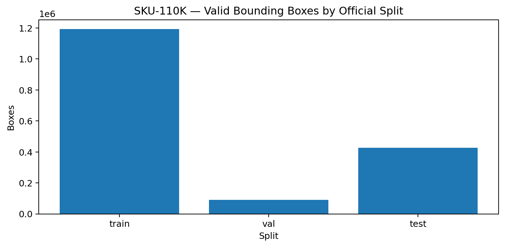

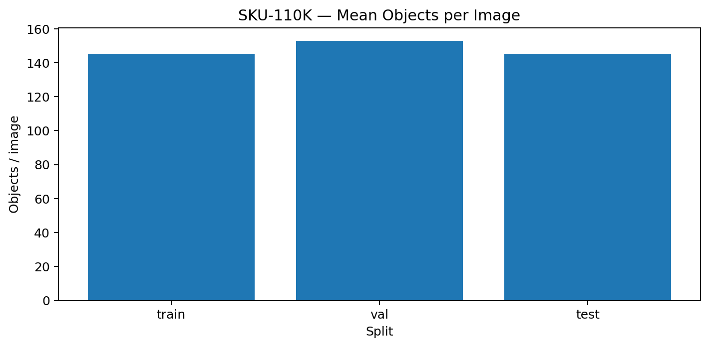

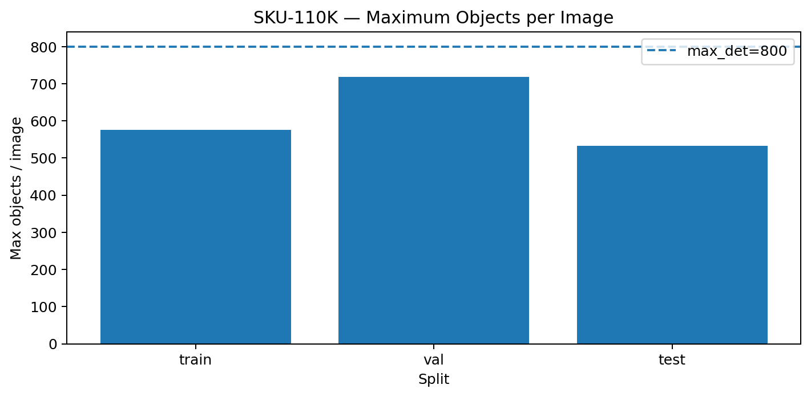

---

## Annotation Format

```text
image,x1,y1,x2,y2,class,image_width,image_height
```

Rows are removed for non-numeric coordinates, invalid geometry, negative coordinates, boxes outside declared dimensions, or missing source images. No labels are changed based on model predictions.

---

## YOLO Conversion Audit

| Split | Images | Labels | Boxes | Bad Label Lines |
|---|---:|---:|---:|---:|
| Train | 8,219 | 8,219 | 1,193,564 | 0 |
| Validation | 588 | 588 | 89,937 | 0 |
| Test | 2,936 | 2,936 | 426,335 | 0 |

Relevant reports:

```text
reports/source_audit.json
reports/conversion_summary.json
reports/converted_dataset_audit.json
reports/invalid_annotation_rows.csv
```

---

## Model

### Champion

```text
YOLO11s
```

Checkpoint:

```text
models/shelfsense_yolo11s_best.pt
```

Training: `36 epochs`  
Best epoch: `30`

### Best Training-Validation Checkpoint

| Metric | Value |
|---|---:|
| Precision | 91.177% |
| Recall | 87.349% |
| mAP50 | 93.585% |
| mAP50-95 | 58.545% |

### Training Evidence


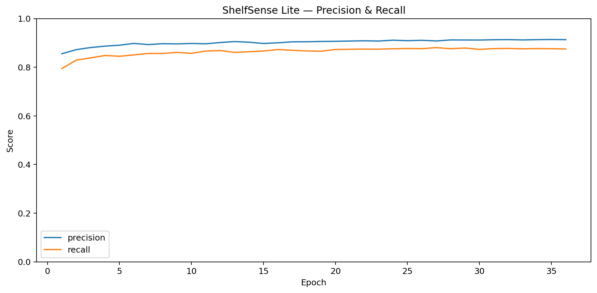

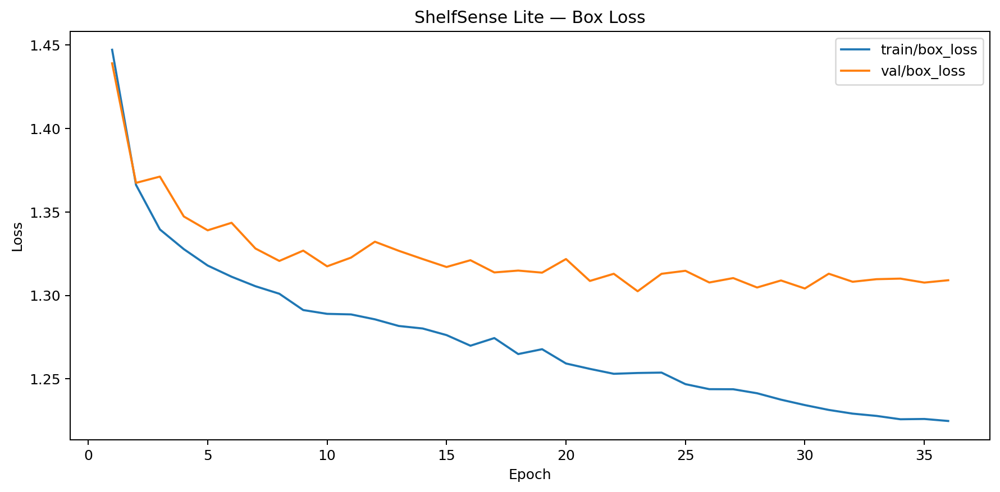

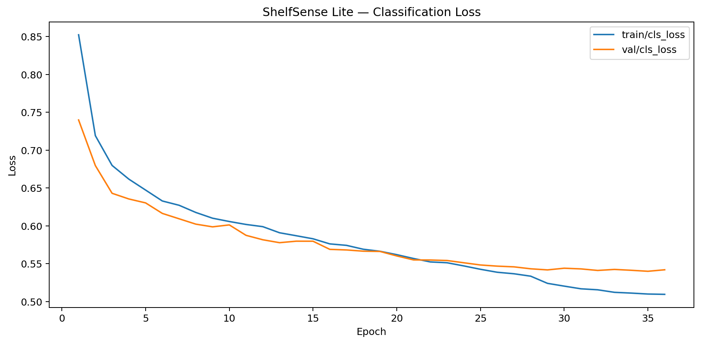

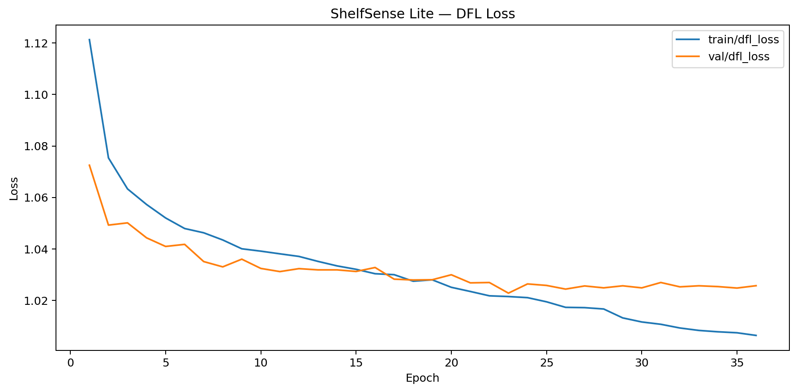

---

## Final Detection Evaluation

Evaluation protocol:

```text
imgsz   = 960
conf    = 0.001
iou     = 0.70
max_det = 800
```

### Final Validation

| Metric | Value |
|---|---:|
| Precision | 91.195% |
| Recall | 87.357% |
| mAP50 | 93.589% |
| mAP50-95 | 58.670% |

### Official Held-Out Test

The canonical test split contains `2,936` images. One source image, `test_274.jpg`, was truncated / unreadable and ignored by Ultralytics.

Final usable test set:

```text
2,935 images
426,209 evaluated instances
```

### Final Test Metrics

| Metric | Value |
|---|---:|
| Precision | **91.067%** |
| Recall | **88.199%** |
| mAP50 | **94.357%** |
| mAP50-95 | **59.180%** |

### Evaluation Speed on Tesla T4

| Stage | ms / image |
|---|---:|
| Preprocess | 1.42 |
| Inference | 12.71 |
| Postprocess | 2.23 |

These numbers are environment-specific.

### Detection Evidence


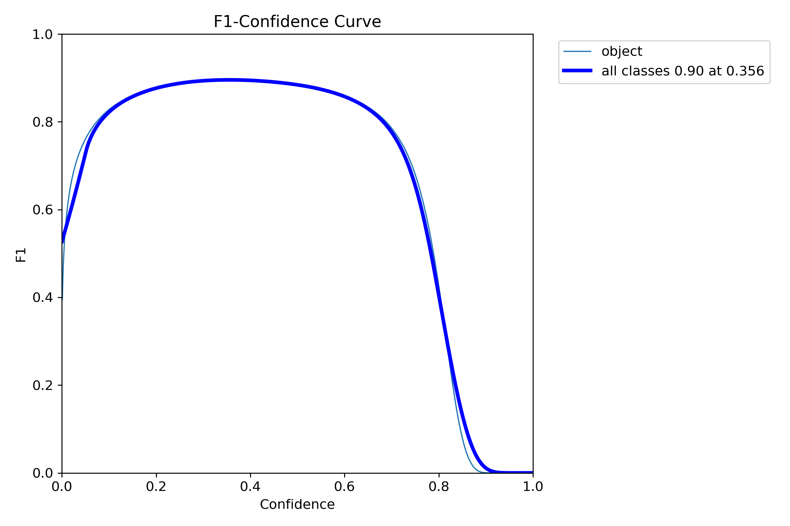

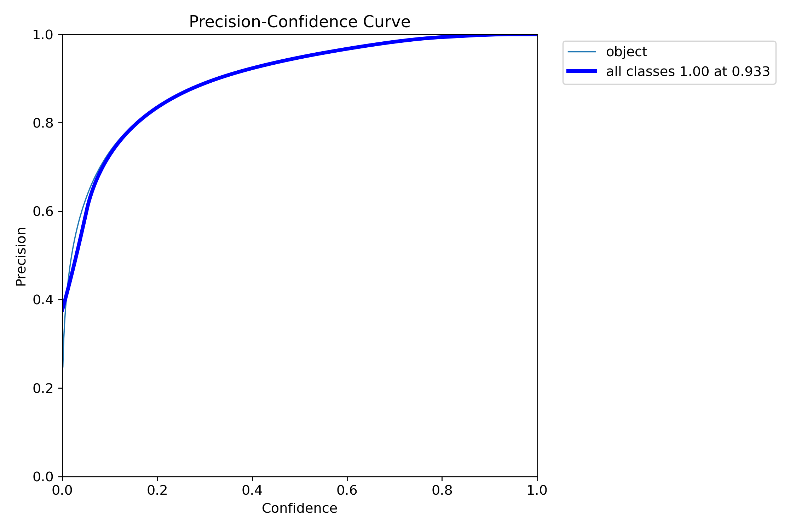

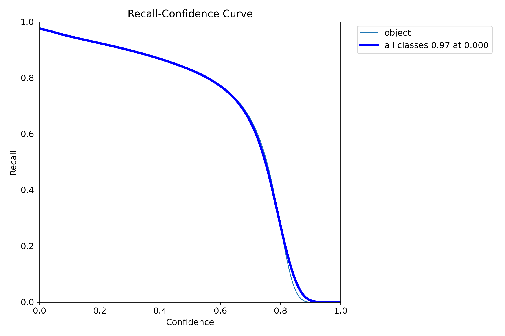

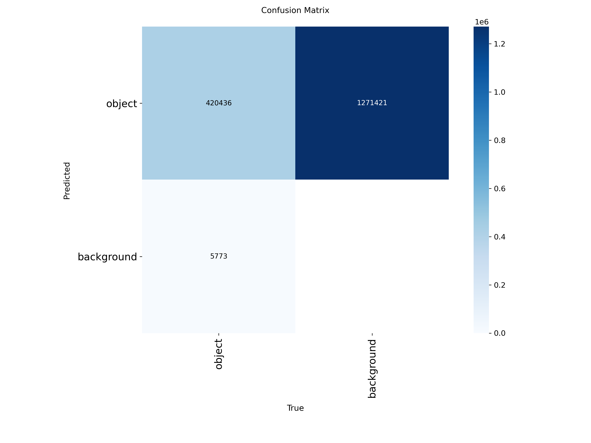

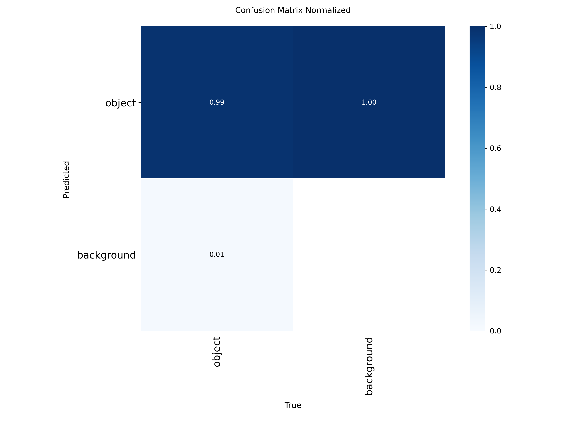


---

## Visible-Product Counting

Visible-product counting is derived from detections:

```python
visible_count = len(detections)
```

It is not a separately trained counting model.

### Threshold Selection

| Confidence | MAE | RMSE | Bias |
|---:|---:|---:|---:|
| 0.10 | 35.72 | 54.65 | +34.61 |
| 0.15 | 24.61 | 39.47 | +21.33 |
| 0.20 | 18.28 | 31.12 | +12.57 |
| 0.25 | 14.93 | 27.23 | +6.08 |
| **0.30** | **13.76** | **26.54** | **+0.61** |
| 0.35 | 14.12 | 27.84 | -4.49 |
| 0.40 | 15.68 | 30.36 | -9.23 |

Therefore `confidence = 0.30` was locked before official test counting.

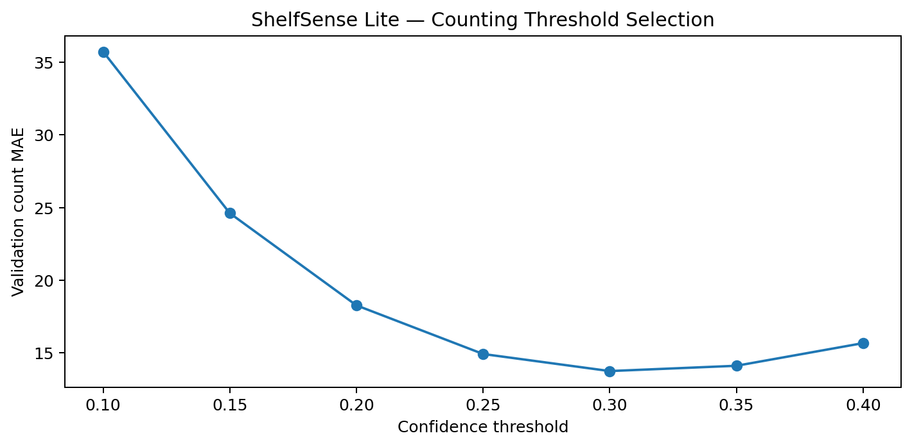

### Official Test Counting

| Metric | Value |
|---|---:|
| Confidence | 0.30 |
| Evaluated images | 2,935 |
| MAE | **12.95 products / image** |
| RMSE | **22.98** |
| Bias | **+1.92** |
| Mean Ground Truth | 145.22 |
| Mean Prediction | 147.14 |


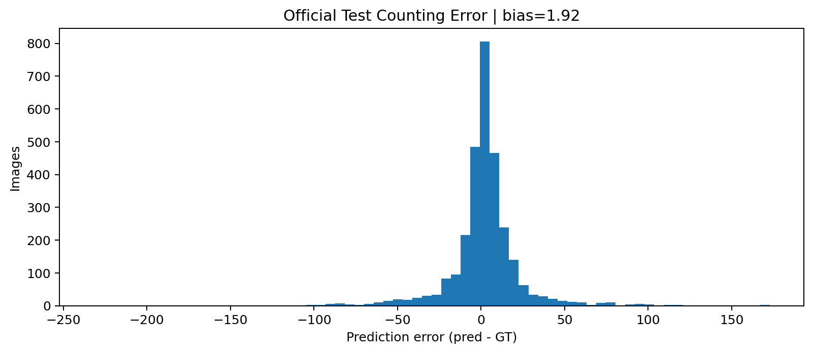

### Error Distribution

| Statistic | Absolute Error |
|---|---:|
| P50 | 7 |
| P75 | 15 |
| P90 | 30 |
| P95 | 49 |

Observed extremes:

```text
Maximum under-count = -232
Maximum over-count  = +173
```

### Failure Analysis


Relevant reports:

```text
reports/test_count_predictions.csv
reports/count_error_summary.json
reports/test_qualitative_samples.csv
```

---

## Streamlit App

Current features:

- upload shelf image;
- run YOLO11s;
- display original image;
- visualize detections;
- show visible-product count;
- show confidence statistics;
- adjust confidence and IoU;
- inspect bounding-box coordinates.

---

## Installation

### Clone

```bash
git clone https://github.com/MENSTRUE/ShelfSense-Lite.git
cd ShelfSense-Lite
```

### Virtual Environment

Windows:

```powershell
python -m venv .venv
.\.venv\Scripts\Activate.ps1
```

Linux / macOS:

```bash
python3 -m venv .venv
source .venv/bin/activate
```

### Install Dependencies

```bash
pip install -r requirements.txt
```

### Run App

```bash
streamlit run app/app.py
```

or:

```bash
python -m streamlit run app/app.py
```

---

## Inference API

```python
from src.inference import ShelfSenseDetector

detector = ShelfSenseDetector()
result = detector.predict("shelf.jpg")

print(result.count)
print(result.mean_confidence)
print(result.boxes)
```

---

## Repository Structure

```text
ShelfSense-Lite/
├── app/
│   └── app.py
├── assets/
│   ├── dataset/
│   ├── evaluation/
│   ├── predictions/
│   ├── screenshots/
│   └── training/
├── models/
│   └── shelfsense_yolo11s_best.pt
├── notebooks/
│   ├── shelfsense-lite part 1.ipynb
│   └── shelfsense-lite part 2.ipynb
├── reports/
├── src/
│   ├── __init__.py
│   ├── inference.py
│   └── utils.py
├── tests/
│   └── test_inference.py
├── .gitignore
├── AGENTS.md
├── LICENSE
├── README.md
└── requirements.txt
```

---

## Source of Truth

```text
1. reports/final_summary.json
2. reports/test_detection_metrics.json
3. reports/test_count_metrics.json
4. reports/validation_detection_metrics.json
5. reports/best_epoch_summary.json
6. reports/source_audit.json
7. notebooks/
8. README.md
```

---

## Claim Boundaries

### Supported

- dense retail-product detector;
- generic retail object detector;
- visible-product detector;
- visible-product counter;
- detection-derived counting MVP.

Supported benchmark claims:

```text
Precision ≈ 91.07%
Recall ≈ 88.20%
mAP50 ≈ 94.36%
mAP50-95 ≈ 59.18%
Counting MAE ≈ 12.95 products/image
RMSE ≈ 22.98
```

### Unsupported

Do not interpret these as inventory accuracy, SKU recognition accuracy, counting accuracy percentage, brand recognition, exact stock, stock availability, or planogram compliance.

---

## Reproducibility

Training notebook:

```text
notebooks/shelfsense-lite part 1.ipynb
```

Final evaluation notebook:

```text
notebooks/shelfsense-lite part 2.ipynb
```

The evaluation notebook covers checkpoint validation, dataset audit, YOLO conversion, training-history recovery, validation, official test, threshold selection, test counting, failure analysis, asset generation, and final reports.

---

## Reports

| File | Purpose |
|---|---|
| `final_summary.json` | Main project result summary |
| `test_detection_metrics.json` | Held-out test detection |
| `validation_detection_metrics.json` | Final validation |
| `test_count_metrics.json` | Counting metrics |
| `count_threshold_search_validation.csv` | Validation threshold search |
| `count_error_summary.json` | Counting failure statistics |
| `test_count_predictions.csv` | Per-image counts |
| `source_audit.json` | Raw dataset audit |
| `converted_dataset_audit.json` | YOLO conversion audit |
| `training_history.csv` | Epoch history |

---

## Testing

Target coverage:

- model loading;
- invalid model path;
- valid image inference;
- invalid image input;
- zero-detection case;
- confidence range;
- bounding-box shape;
- count consistency;
- CPU fallback;
- Streamlit import smoke test.

---

## Deployment

Current supported mode:

```text
Local Streamlit Application
```

Future options include Docker, FastAPI, ONNX Runtime, cloud deployment, GPU inference service, CPU service, and edge deployment after optimization.

---

## Limitations

### Model
- single generic class;
- no SKU identity;
- no brand recognition;
- no OCR;
- small or heavily occluded objects may be missed;
- repetitive patterns may produce false positives;
- difficult scenes may have large counting errors.

### Dataset
- benchmark is SKU-110K-specific;
- external store layouts may differ;
- packaging, lighting, and perspective may differ;
- one test image is corrupt.

### App
- local-only MVP;
- no database;
- no authentication;
- no production API;
- no video;
- no monitoring;
- no drift detection;
- no retail-system integration.

---

## Responsible Use

ShelfSense Lite should currently be treated as a research / portfolio MVP. It should not automatically drive operational inventory decisions.

---

## Roadmap

### Data
- [x] Official split preserved
- [x] Annotation audit
- [x] Invalid row removal
- [x] Density analysis
- [x] Corrupt image documented
- [ ] External retail test set
- [ ] Cross-store evaluation
- [ ] Domain-shift analysis

### Model
- [x] YOLO11s
- [x] Dense detector
- [x] `max_det=800`
- [x] Final test
- [x] Validation-only threshold
- [x] Counting evaluation
- [ ] YOLO11n comparison
- [ ] YOLO11m comparison
- [ ] ONNX
- [ ] quantization
- [ ] tiling experiment

### Product
- [x] Streamlit app
- [x] Image upload
- [x] Bounding boxes
- [x] Visible count
- [x] Confidence statistics
- [ ] annotated image download
- [ ] batch images
- [ ] video
- [ ] example gallery
- [ ] better mobile layout

### Testing
- [ ] unit tests
- [ ] integration tests
- [ ] inference regression tests
- [ ] Streamlit smoke test
- [ ] GitHub Actions CI

### Deployment
- [ ] Docker
- [ ] FastAPI
- [ ] ONNX Runtime
- [ ] cloud deployment
- [ ] CPU benchmark
- [ ] memory benchmark
- [ ] monitoring

---

## Troubleshooting

### Model Not Found
Expected:

```text
models/shelfsense_yolo11s_best.pt
```

### Ultralytics Not Installed

```bash
pip install -r requirements.txt
```

### Streamlit Not Found

```bash
python -m streamlit run app/app.py
```

### CUDA Unavailable

```python
import torch
print(torch.cuda.is_available())
```

### Too Many Detections
Increase confidence. Validated counting default is `0.30`.

### Too Few Detections
Lower confidence carefully. At `conf=0.10`, validation bias was approximately `+34.61 products/image`.

### `sku110k.yaml` Contains Kaggle Path
That file is a historical evaluation artifact. The local app does not need it.

### Streamlit `use_container_width` Warning
This is a UI compatibility warning, not a YOLO inference error.

---

## FAQ

### Is this SKU recognition?
No. The detector predicts only `object`.

### Does `Visible Products = 208` mean exactly 208 items physically exist?
No. It means 208 detections passed the inference threshold.

### Is confidence inventory confidence?
No. Detection confidence is a model score for a predicted box.

### Why `max_det=800`?
Because dataset audit found a validation image with 718 valid objects.

### Why confidence `0.30`?
It produced the lowest validation counting MAE among tested thresholds.

### Was test data used to choose confidence?
No. Threshold selection used validation only.

### Why only 2,935 test images?
One source image, `test_274.jpg`, was truncated / unreadable.

### Is mAP50 94.36% equal to counting accuracy?
No. mAP50 is an object-detection metric. Counting is evaluated separately using MAE, RMSE, and bias.

### Can this replace inventory systems?
No.

---

## Technology Stack

- Python
- PyTorch
- Ultralytics YOLO
- OpenCV
- NumPy
- Pandas
- Pillow
- Matplotlib
- Streamlit
- Kaggle
- Git
- GitHub

---

## License

Project source code is released under the MIT License. Dataset licensing is separate, and ShelfSense Lite does not relicense SKU-110K.

---

## Author

**Wafa Bila Syaefurokhman**

GitHub: https://github.com/MENSTRUE  
Repository: https://github.com/MENSTRUE/ShelfSense-Lite

---

## Final Statement

ShelfSense Lite demonstrates an end-to-end workflow:

```text
understand the dataset
→ audit annotations
→ train the detector
→ preserve official splits
→ evaluate on held-out data
→ tune counting only on validation
→ measure test counting separately
→ inspect failures
→ expose inference through an application
```

The project is intentionally positioned as a **dense visible-product detection and counting MVP**, not a complete retail inventory system.
